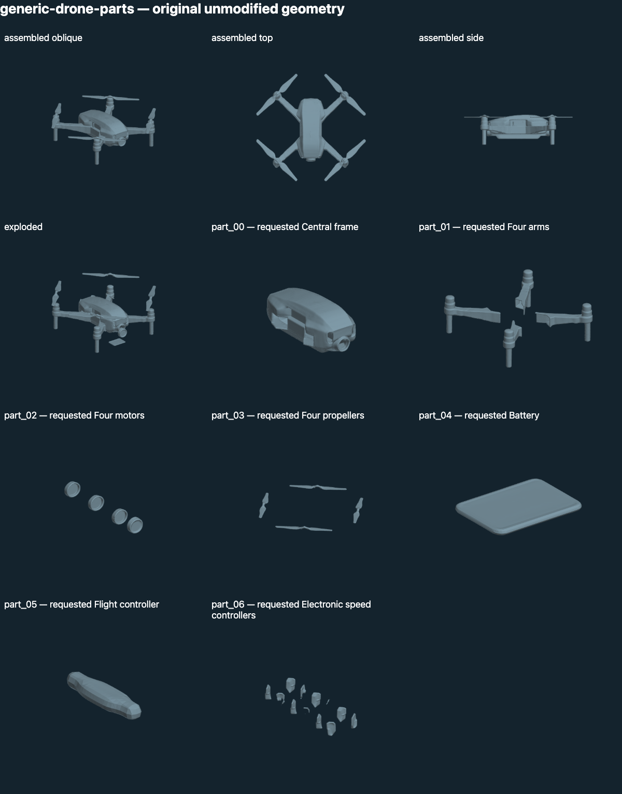
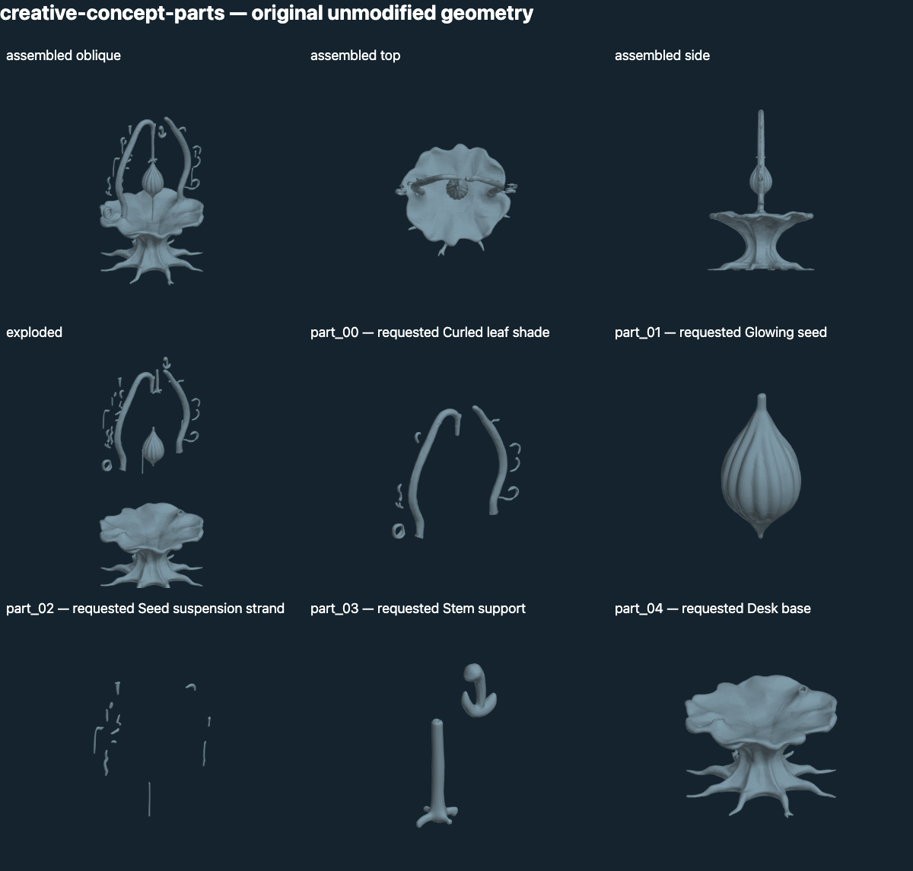

# Cube geometry comparison 001: result

**The application-owned pipeline ran, but this configuration failed the frozen
component-quality and cross-object coverage gate. Stop this configuration here.**

The [protocol](CUBE_COMPARISON.md) was committed before rental (`aadebeb`). ORYN's
unchanged model-generated object descriptions went to Cube 3D; unchanged component
names and the resulting whole meshes went to CubePart. Codex launched the research
worker and reviewed outputs; it did not design, name or repair replacement meshes.
The [measured record](results/cube-comparison-001.json) retains stage timings,
parameters, hashes, scorecards, disconnected-piece counts and cleanup evidence.

| Case | Observed result | Frozen score / decision |
| --- | --- | --- |
| Generic drone | Coherent exterior and recognizable propellers; incomplete motor boundaries and fragmented alleged electronics | 7/10; fail |
| Generic speaker | Nine planned groups exceed the released pipeline's eight slots; plan was preserved without merging | Unsupported; not dispatched |
| Exact JBL internals | Existing evidence requirement retained | Correctly blocked; not dispatched |
| Creative leaf/seed lamp | Suspended seed survives, but leaf intent shifts and shade/support/strand groups contain mismatched fragments | 6/10; fail |

A geometry pass required 2/2 on **every** dimension, not just a high total. These
are Codex's qualitative scores against the predeclared criteria, not independent
human acceptance. Four inference stages completed, zero retries, zero repairs.

## What the geometry shows

The drone whole shape contains 135,116 triangles. Its seven generated groups
contain 516,408 triangles. Four indexed pieces appear in each arm, motor and
propeller group, but groups have no individual-instance bindings. The motor group
looks like caps, with much of the cylindrical housing still in the arm group.
The speed-controller label maps to 16 disconnected pieces; neither that name nor
the output count establishes useful internal electronics.

The lamp whole shape contains 224,740 triangles. Its five generated groups contain
526,656 triangles. The seed is recognizable, but the proposed leaf shade maps to
14 arch/vine pieces, suspension strand to 12 pieces, and stem support to two.
The assembled form can look coherent while the requested components are wrong.
Glow/materials were not tested by neutral geometry rendering.

Standalone GLBs passed existing static checks. Aggregate part vertices are 258,242
for the drone and 263,386 for the lamp, each above the 200,000-vertex single-asset
preflight limit. No combined production asset or Quest import was approved or
performed. The inspector retains original files and unknown semantics; its
explode/reset is a geometric inspection operation, not physical disassembly.

## Cost and cleanup

One A100 80 GB rental ran for approximately 17.89 minutes, including setup
and downloads. Estimated compute plus ephemeral disk: **$0.4782**, below the
$3.50 ceiling. Billing had not settled for this rental at cleanup. The pod was
terminated after the archive and all 14 original meshes were verified; independent
account listings confirmed **zero pods and zero network volumes**.

Initial setup needed a Python virtual environment before inference. A temporary
connection timeout during the final stage recovered without rerunning inference.
Both events and the upstream config warning are preserved. No production keys,
headset data or object library were sent to the worker.

## Decision and next question

This is evidence that a shared planning-to-geometry route can run for different
concepts. It is also evidence that this particular whole-shape-then-parts route
is insufficient for the requested component fidelity. It does not establish the
limits of every model or justify training or per-object repairs.

Keep the planner unchanged. Stop this configuration without extra seeds. Before
another paid run, assess approaches that can construct parts and their spatial
relationships together, including internal roles, and support the unmodified
speaker plan. Do not turn the eight-slot constraint into a new hand-curated plan,
or accept an exterior shape as proof of an intelligent complete object.

Local viewer: `http://127.0.0.1:8775/cube-review-001/` while the local server runs.
All original files/logs remain in `Builds/NativeObjects/cube-complete-001` (ignored
by Git). Reproduce inspection with `Research.native_objects.inspect_cube`.
Seven bridge/inspection and 22 existing geometry tests passed. Browser inspection
loaded all four cases without page errors; selection and explode/reset worked
for both part sets, with motion disabled. Quest and live manipulation remain
untested. Cube remains a research-only evaluation, not a production integration.
